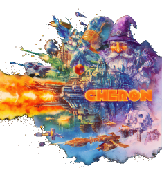

  

  &nbsp;
  &nbsp; <!-- Alpha = Red, Beta = Yellow, Stable = Green -->
  &nbsp;
  &nbsp;

***

<h6 align="center">

  [MANUAL](docs/man/README.md)&nbsp;&bull;&nbsp;[CHANGELOG](docs/CHANGELOG.md)&nbsp;&bull;&nbsp;[ROADMAP](docs/ROADMAP.md)&nbsp;&bull;&nbsp;[KNOWN ISSUES](docs/KNOWN-ISSUES.md)

</h6>

| CONTENTS                                    |
|---------------------------------------------|
| [About Cheron](#about-%ProjectName%) |
| [How it works](#how-it-works)               |
| [Getting started](#getting-started)         |
| [Installing](#installing)                   |
| [Usage](#usage)                             |
| [Acknowledgements](#acknowledgements)       |
| [Related projects](#related-projects)       |
| [License](#license)                         |

***

## About Cheron

A brief description of the project, what it does, and who it's for. This should
be a concise summary that gives readers a clear understanding of the project's
purpose and value proposition.

### Features

* Feature — What it does and why it matters.
* Feature — What it does and why it matters.
* Feature — What it does and why it matters.

## How it works

A blurb describing how the project works at a high level.

## Getting started

A quick overview of how to get started with the project.

### Before you begin

Any assumptions, or other information a user should know before

### Requirements

| Requirement | Minimum version | Notes |
|-------------|-----------------|-------|
| Requirement |                 |       |
| Requirement |                 |       |
| Requirement |                 |       |

## Installing

Quick summary of installation instructions, or link to the Installing documentation.

## Usage

Step-by-step instructions for using the project on supported platforms.

## Documentation

Documentation is available.

## Acknowledgements

None.

## Built with

* [Technology or framework](URL)  - Role it plays in the project.
* [Technology or framework](URL)  - Role it plays in the project.
* [Technology or framework](URL)  - Role it plays in the project.

## Related projects

None.

## License

Copyright &copy; 2026 [A Pretty Cool Program](https://github.com/APrettyCoolProgram)  
Distributed under the [Apache 2.0 License](LICENSE)  

***

<h6 align="center">

  [FAQ](docs/FAQ.md)&nbsp;&bull;&nbsp;[DEVELOPMENT](docs/DEVELOPMENT.md)&nbsp;&bull;&nbsp;[API](docs/api/README.md)&nbsp;&bull;&nbsp;[SUPPORT](docs/SUPPORT.md)&nbsp;&bull;&nbsp;[NOTICES](docs/NOTICES.md)

</h6>
