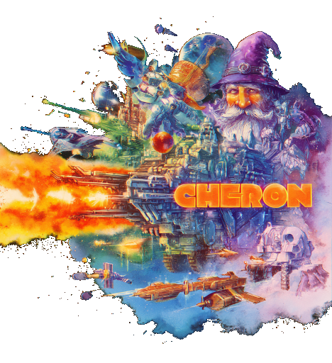

<div align="center">

  

  &nbsp;
  &nbsp;
  &nbsp;
  
  &nbsp;

</div>

***

<h6 align="center">

  [MANUAL](docs/man/README.md)&nbsp;&bull;&nbsp;[CHANGELOG](docs/CHANGELOG.md)&nbsp;&bull;&nbsp;[ROADMAP](docs/ROADMAP.md)&nbsp;&bull;&nbsp;[KNOWN ISSUES](docs/KNOWN-ISSUES.md)

</h6>

***

| CONTENTS                                    |
|---------------------------------------------|
| [About Cheron](#about-Cheron)               |
| [Documentation](#documentation)             |
| [Usage](#usage)                             |
| [License](#license)                         |

***

# About Cheron

Cheron is:

1. **A game engine**  
The *idea* is to create a game engine that can be used to create and play a variety of different game types.

Cheron is developed

2. **An experiment**  
I'm using AI to build Cheron. Why? [Because *experimenting*!](./docs/making-of/README.md)

## Requirements

- [.NET 10 SDK](https://dotnet.microsoft.com/en-us/download)
- A desktop environment supported by MonoGame DesktopGL.

# Documentation

There's a variety of different documentation to peruse:

* The [Cheron manual](./docs/man/README.md)
* The aforementioned [Making of Cheron](./docs/making-of/README.md)
* The [development documentation](.github/development/README.md)

# Using

## Build and run

Clone the repository and enter its directory:

```shell
git clone https://github.com/APrettyCoolProgram/Cheron.git
cd Cheron
```

Build the solution:

```shell
dotnet build src/Cheron.slnx
```

Run the game:

```shell
dotnet run --project src/Cheron.csproj
```

## Tests

Run the Solitaire test suite:

```shell
dotnet test src/Solitaire.Tests/Solitaire.Tests.csproj
```

## Project layout

```text
src/
├── Engine/             Game host, module contract, and start screen
├── Games/Solitaire/    Shared Solitaire systems and Klondike/FreeCell variants
├── Solitaire.Tests/    xUnit tests
├── Program.cs          Application entry point
└── Cheron.csproj
```

# License

Copyright &copy; 2026 [A Pretty Cool Program](https://github.com/aprettycoolprogram)  
Distributed under the [Apache 2.0 License](LICENSE)  

***

<h6 align="center">

  [FAQ](docs/FAQ.md)&nbsp;&bull;&nbsp;[DEVELOPMENT](docs/DEVELOPMENT.md)&nbsp;&bull;&nbsp;[API](docs/api/README.md)&nbsp;&bull;&nbsp;[SUPPORT](docs/SUPPORT.md)&nbsp;&bull;&nbsp;[NOTICES](docs/NOTICES.md)

</h6>
